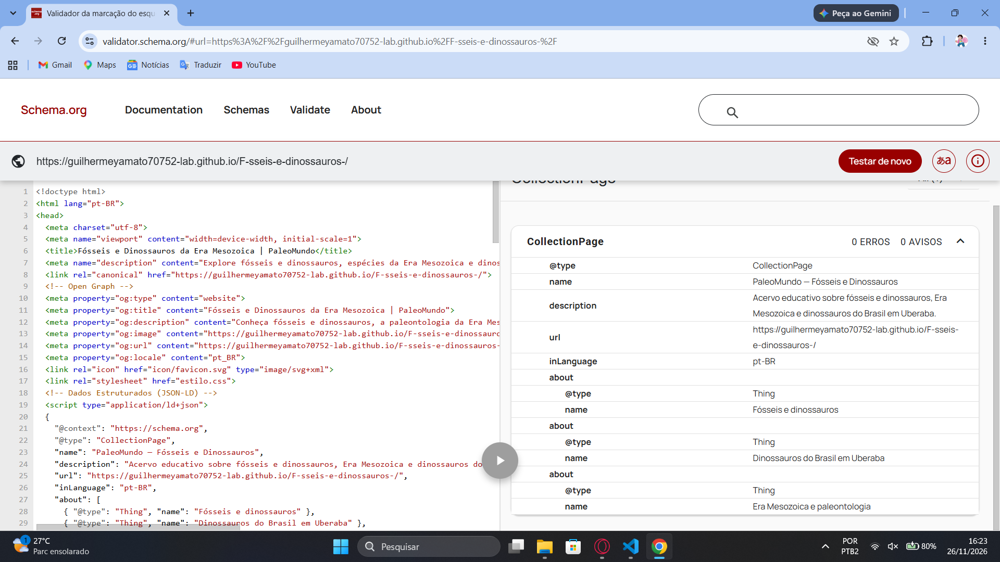
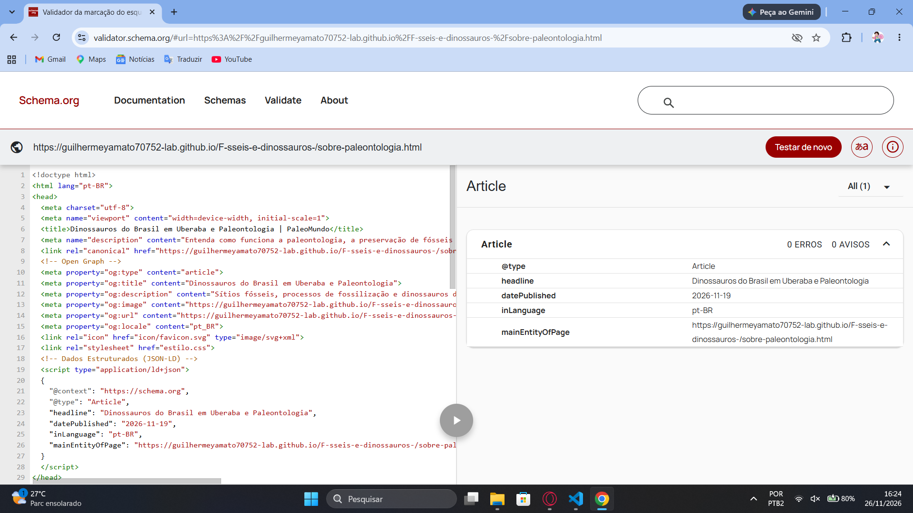
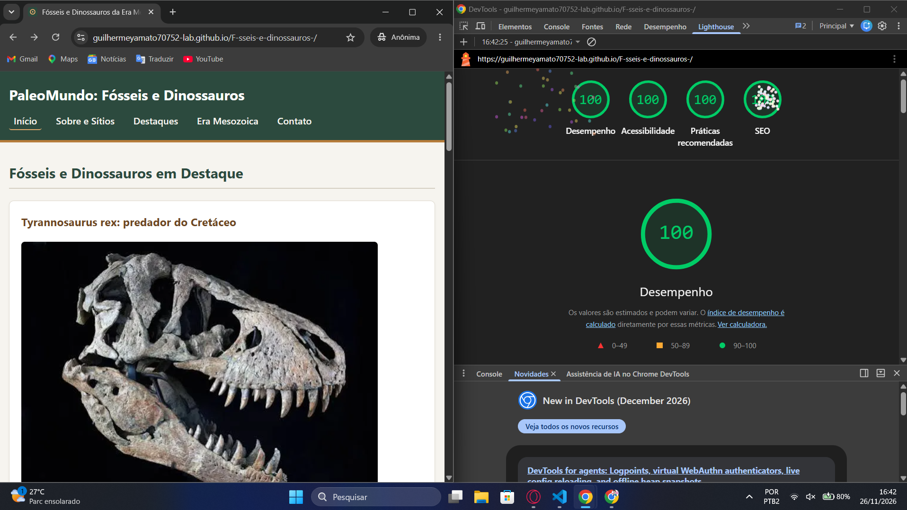

# PaleoMundo — Fósseis e Dinossauros

Projeto desenvolvido para a disciplina **Linguagem de Script para Web** (IFTM - Campus Uberaba Parque Tecnológico, 2026).

- **Tema escolhido:** 10. Fósseis e dinossauros
- **Site publicado (GitHub Pages):** [https://guilhermeyamato70752-lab.github.io/F-sseis-e-dinossauros-/](https://guilhermeyamato70752-lab.github.io/F-sseis-e-dinossauros-/)

## Atividade 1 — Página Semântica
Nesta etapa foi desenvolvida a página inicial do projeto utilizando exclusivamente HTML5 semântico e CSS3 externo responsivo:
- Estruturação com landmarks (`header`, `nav`, `main`, `aside`, `footer`) e link de acessibilidade "Pular para o conteúdo".
- Hierarquia estrita de títulos (`h1` único até `h3` sem saltos de nível).
- Três artigos em destaque utilizando `figure`, `figcaption`, atributos `alt` descritivos e dimensões (`width` e `height`).
- Tabela de períodos geológicos estruturada com `caption`, `thead`, `tbody` e `th` com `scope`.
- Formulário de contato acessível agrupado com `fieldset`/`legend` e todos os campos associados a `label`.

### Validação W3C

## Atividade 2 — SEO Técnico
Nesta etapa o site recebeu otimizações de SEO técnico, documentadas em detalhe no relatório [SEO.md](SEO.md):
- Segunda página (`sobre-paleontologia.html`) com `title`, `meta description` e `canonical` próprios, ligada à página inicial por links internos descritivos.
- Tags Open Graph, imagem de compartilhamento em 1200×630 px (`img/og-paleomundo.jpg`) e `favicon.svg`.
- Dados estruturados em JSON-LD: `CollectionPage` na página inicial e `Article` na página "Sobre", ambos validados no validator.schema.org.
- Imagens em WebP, com `alt` descritivo, `width` e `height` reais e `loading="lazy"` nas imagens abaixo da primeira tela.
- `robots.txt` e `sitemap.xml` na raiz do projeto.

### Validação do JSON-LD

### Resultado no Lighthouse
Os valores completos (antes e depois) estão no [SEO.md](SEO.md).

