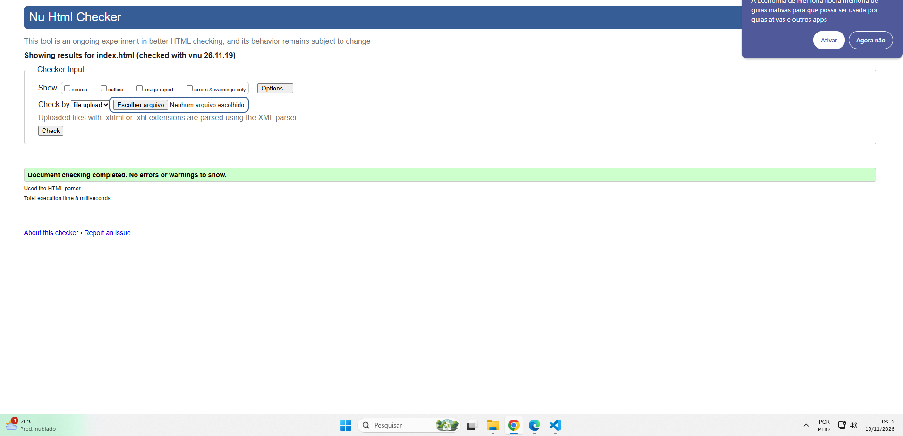

# PaleoMundo — Fósseis e Dinossauros

Projeto desenvolvido para a disciplina **Linguagem de Script para Web** (IFTM - Campus Uberaba Parque Tecnológico, 2026).

- **Tema escolhido:** 10. Fósseis e dinossauros
- **Site publicado (GitHub Pages):** [Inserir link do seu GitHub Pages aqui]

## Atividade 1 — Página Semântica
Nesta etapa foi desenvolvida a página inicial do projeto utilizando exclusivamente HTML5 semântico e CSS3 externo responsivo:
- Estruturação com landmarks (`header`, `nav`, `main`, `aside`, `footer`) e link de acessibilidade "Pular para o conteúdo".
- Hierarquia estrita de títulos (`h1` único até `h3` sem saltos de nível).
- Três artigos em destaque utilizando `figure`, `figcaption`, atributos `alt` descritivos e dimensões (`width` e `height`).
- Tabela de períodos geológicos estruturada com `caption`, `thead`, `tbody` e `th` com `scope`.
- Formulário de contato acessível agrupado com `fieldset`/`legend` e todos os campos associados a `label`.

### Validação W3C

