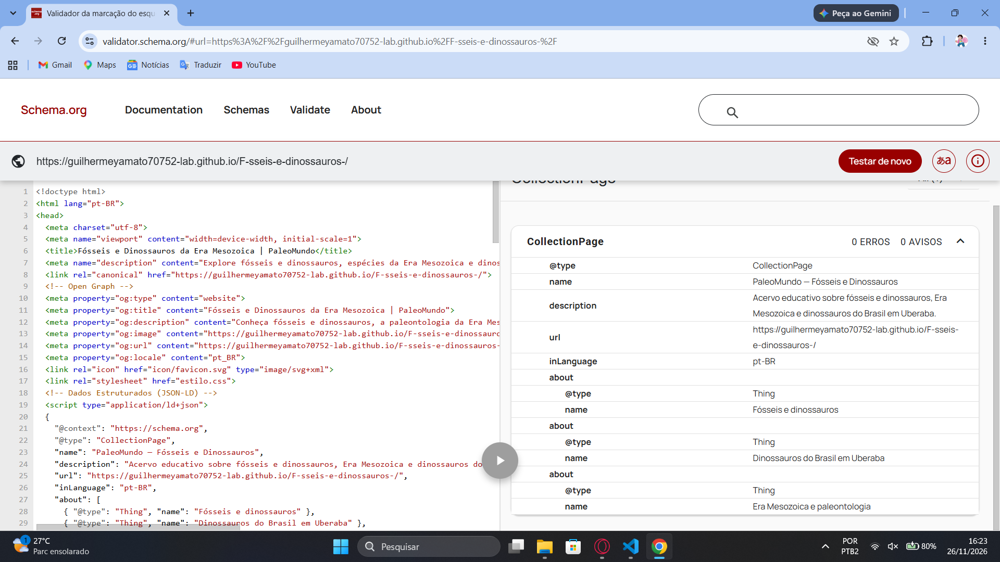
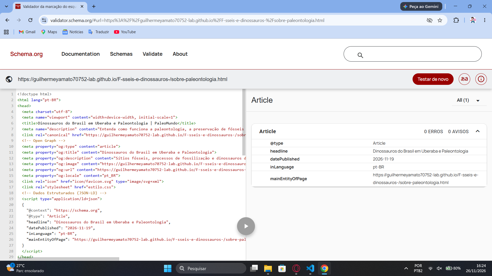
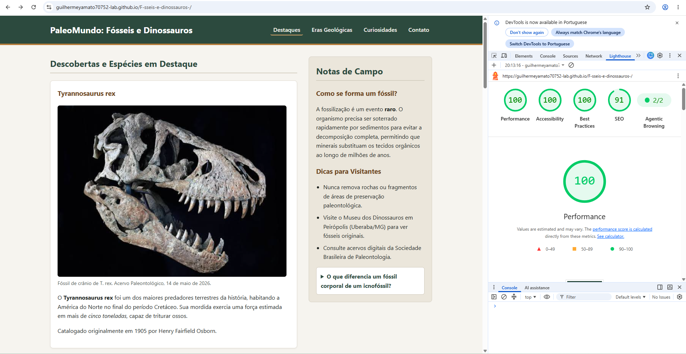
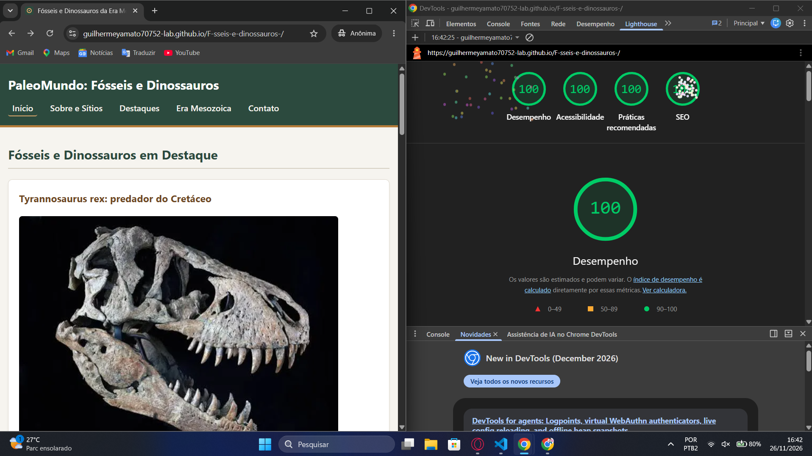

# Relatório de SEO — Atividade 2 (Fósseis e Dinossauros)

- **Site publicado:** https://guilhermeyamato70752-lab.github.io/F-sseis-e-dinossauros-/
- **Repositório:** https://github.com/guilhermeyamato70752-lab/F-sseis-e-dinossauros-
- **Tema:** 10. Fósseis e dinossauros (PaleoMundo)

## Palavras-chave escolhidas

| # | Palavra-chave | Onde aparece |
| :-: | :--- | :--- |
| 1 | `fósseis e dinossauros` | `title` e `description` da página inicial, `h1`, `h2`, texto e `alt` das imagens |
| 2 | `dinossauros do brasil uberaba` | `title` e `description` da página "Sobre", `h3` e texto |
| 3 | `era mesozoica paleontologia` | `description` da página inicial, tabela de períodos e texto |

## Tipos schema.org (JSON-LD)

| Página | Tipo | Justificativa |
| :--- | :--- | :--- |
| `index.html` | `CollectionPage` | A página reúne um acervo de fósseis e dinossauros em destaque |
| `sobre-paleontologia.html` | `Article` | Conteúdo informativo sobre sítios paleontológicos, com `headline` e `datePublished` |

Validação em `validator.schema.org`:

## Decisões de otimização

- **Título e descrição únicos por página**, cada um voltado a uma palavra-chave diferente, com `canonical` próprio em cada página.
- **Open Graph completo** (`og:type`, `og:title`, `og:description`, `og:image`, `og:url`, `og:locale`) e `favicon.svg`. A imagem de compartilhamento tem 1200×630 px e URL absoluta.
- **Dados estruturados em JSON-LD** no `head` das duas páginas.
- **Imagens otimizadas:** formato WebP, `alt` descritivo, `width` e `height` com as dimensões reais de cada arquivo e `loading="lazy"` nas imagens abaixo da primeira tela. Nomes de arquivo sem acento.
- **`robots.txt` e `sitemap.xml`** na raiz do projeto, com as URLs absolutas do site publicado e `lastmod` com a data real.
- **Links internos descritivos** entre as duas páginas (por exemplo, "sobre paleontologia e sítios fósseis" e "lista de fósseis e dinossauros em destaque"), sem "clique aqui".
- **URLs amigáveis:** `index.html` e `sobre-paleontologia.html`.
- **HTML semântico e acessível:** um único `h1` por página, landmarks (`header`, `nav`, `main`, `aside`, `footer`) e link "Pular para o conteúdo".

## Auditoria Lighthouse (Dispositivo: Celular)

| Categoria | Antes | Depois |
| :--- | :---: | :---: |
| Desempenho | 100 | 91 |
| Acessibilidade | 100 | 100 |
| Boas práticas | 100 | 100 |
| SEO | 91 | 100 |

- **Antes:** versão da Atividade 1, só com HTML semântico. O SEO ficou em 91 por falta de `meta description`.
- **Depois:** versão com o `head` otimizado, JSON-LD, imagens ajustadas, `robots.txt` e `sitemap.xml`.
- **Metas da atividade:** SEO ≥ 95 (atingido: 100) e Acessibilidade ≥ 90 (atingido: 100).

## Observações

- O `robots.txt` e o `sitemap.xml` ficam na raiz do projeto. Em GitHub Pages de projeto (`usuario.github.io/nome-do-repositorio/`), a raiz do domínio é `usuario.github.io`, então os robôs não leem o `robots.txt` da subpasta. Os arquivos foram mantidos mesmo assim, por exigência da atividade, e o sitemap pode ser enviado pelo Google Search Console.
- Prévia de compartilhamento testada em opengraph.xyz.